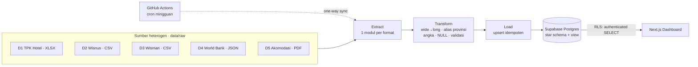

# Nusantara Tourism Hub — Dashboard EVD Pariwisata Indonesia

Tugas kelompok **Enterprise Application Integration (EAI)**, topik **Data-level EAI**.
Program Studi Teknologi Sains Data, FTMM Universitas Airlangga.

Proyek ini adalah website dashboard *exploratory data visualization* (EVD) dengan login, dibangun di atas
**5 dataset publik pariwisata Indonesia dalam 4 format berbeda (XLSX, CSV, JSON, PDF)**. Prinsip utamanya:
dashboard **tidak pernah membaca file mentah**. Semua sumber masuk lewat pipeline **Extract → Transform → Load**
ke **satu database terpusat (Supabase Postgres)** yang berperan sebagai *hub* integrasi, lalu website hanya membaca
dari hub tersebut.

> Screenshot: *(tambahkan `docs/screenshots/*.png` setelah deploy)*
>
> | Overview | Analisis Provinsi | Pipeline ETL | Tabel Data |
> |---|---|---|---|
> |  |  |  |  |

---

## Arsitektur singkat



| Lapisan | Teknologi |
|---|---|
| Frontend | Next.js 15 (App Router, TypeScript), Tailwind CSS v4, ECharts (`echarts-for-react`), `lucide-react`, Plus Jakarta Sans |
| Auth & DB | Supabase Auth + Postgres (`@supabase/ssr`), RLS aktif |
| ETL | Python 3.11 (pandas, openpyxl, pdfplumber, psycopg 3) |
| Penjadwalan | GitHub Actions (`.github/workflows/etl.yml`) |
| Deploy | Vercel |

Struktur repo:

```
data/raw/            file mentah dalam format asli (5 dataset)
data/reference/      tabel referensi pemetaan pintu masuk → provinsi
data/rejected/       baris yang dibuang ETL + alasannya (dihasilkan otomatis)
data/SOURCES.md      katalog sumber data
etl/extract/         csv_extractor, xlsx_extractor, json_extractor, pdf_extractor
etl/transform/       aturan transformasi per dataset + common.py
etl/load/            upsert idempoten + pencatatan etl_run / etl_step_log
etl/run_etl.py       entry point pipeline
etl/insights.py      query analitik untuk laporan
supabase/migrations/ skema, seed provinsi, view analitik, RLS
src/                 aplikasi Next.js
docs/LAPORAN.md      draf laporan
```

## Akun demo

| Email | Password |
|---|---|
| `demo@pariwisata.id` | `Demo-KPjFK4wp1GMUFx!9` |

Akun dibuat lewat `npm run seed:demo` (Supabase Admin API, `email_confirm: true`). Pengguna baru juga bisa mendaftar
di halaman `/register`.

## Menjalankan secara lokal

### 1. Prasyarat
- Node.js 20+ dan Python 3.11+
- Project Supabase. Di **Authentication → Providers → Email**, matikan *Confirm email* agar akun hasil register bisa langsung masuk.
- Salin `.env.example` menjadi `.env.local`, lalu isi semua variabel.

### 2. ETL (membuat skema + memuat data)

```bash
python -m venv .venv
.venv/Scripts/activate          # Windows; di macOS/Linux: source .venv/bin/activate
pip install -r etl/requirements.txt
python -m etl.run_etl           # migrasi + extract → transform → load + quality check
```

Opsi lain:
- `python -m etl.run_etl --dry-run` menjalankan Extract dan Transform saja, tanpa database.
- `python -m etl.run_etl --only d5_akomodasi` menjalankan satu dataset.
- `python -m etl.insights` mencetak hasil query untuk bab insight di laporan.

ETL bersifat **idempoten**: menjalankannya berulang kali tidak menggandakan data (upsert `ON CONFLICT DO UPDATE`).

### 3. Web

```bash
npm install
npm run seed:demo    # membuat akun demo
npm run dev          # http://localhost:3000
```

`npm run build` dan `npm run lint` dipakai untuk verifikasi.

## Deploy ke Vercel

1. Import repository ini di vercel.com → *Add New Project*.
2. Isi Environment Variables:
   - `NEXT_PUBLIC_SUPABASE_URL`
   - `NEXT_PUBLIC_SUPABASE_ANON_KEY`
   - `SUPABASE_SERVICE_ROLE_KEY` (tidak dipakai oleh halaman web; hanya untuk skrip server, jangan diberi prefix `NEXT_PUBLIC_`)
3. Deploy. Framework terdeteksi otomatis sebagai Next.js.
4. Di Supabase → Authentication → URL Configuration, tambahkan domain Vercel ke *Site URL / Redirect URLs*.

Dengan CLI: `vercel link`, lalu `vercel env add …`, lalu `vercel --prod`.

## Sinkronisasi terjadwal (GitHub Actions)

Workflow `.github/workflows/etl.yml` berjalan setiap Senin pukul 02:00 WIB dan bisa dipicu manual
(`gh workflow run etl.yml`). Workflow ini memakai secret `DATABASE_URL` dan mencatat run dengan `trigger = scheduled`.
Ini adalah **one-way synchronization** dari sumber ke hub.

```bash
gh secret set DATABASE_URL --body "postgresql://..."
gh workflow run etl.yml
```

## Keamanan
- RLS aktif di semua tabel. Role `authenticated` hanya boleh `SELECT`; `anon` tidak punya hak apa pun pada tabel dan view.
- Penulisan data hanya lewat ETL (koneksi `DATABASE_URL`).
- Semua query web dijalankan di server (Server Components / Route Handler) memakai sesi user. Service role key tidak pernah dikirim ke browser.
- `.env*` di-*ignore* git; hanya `.env.example` yang di-commit.

## Keputusan Teknis

| # | Keputusan | Alasan |
|---|---|---|
| 1 | **Supabase Postgres sebagai hub** dengan *star schema* (`dim_provinsi`, `dim_waktu`, 5 `fact_*`) | Satu sumber kebenaran untuk dashboard. Dimensi bersama adalah kunci integrasi antar-sumber. |
| 2 | `waktu_id = tahun × 100 + bulan` (bulan 00 = tahunan) | Menyeragamkan granularitas bulanan dan tahunan dalam satu dimensi. |
| 3 | **Pemekaran Papua 2022**: data disimpan pada 38 provinsi sesuai publikasi. Kolom `kode_induk` menunjuk provinsi induk, dan halaman Provinsi punya opsi basis 34 provinsi. | Data historis provinsi baru bernilai "-" di sumber. Roll-up ke induk menjaga runtun waktu tetap sebanding tanpa mengarang angka. |
| 4 | Baris agregat nasional BPS disimpan sebagai provinsi kode `0` | Rata-rata TPK nasional BPS tertimbang dan tidak bisa dihitung ulang dari rata-rata provinsi. Untuk wisnus, baris ini dipakai sebagai cek rekonsiliasi. |
| 5 | Subtotal/kolom "Tahunan" **tidak dimuat**, tetapi dipakai untuk validasi silang | Mencegah *double counting*. Total dihitung ulang di view. |
| 6 | Pintu masuk wisman dipetakan ke provinsi lewat `data/reference/pintu_masuk_provinsi.csv`; Soekarno-Hatta → Banten (lokasi administratif) | Agar D3 bisa digabung per provinsi. Pintu "Lainnya" disimpan dengan provinsi NULL. |
| 7 | World Bank dipakai sebagai sumber JSON walaupun datanya berhenti di 2020 | Satu-satunya sumber JSON pariwisata yang publik dan tanpa API key. Nilainya beririsan dengan BPS di 2018–2020 dan memberi pembanding ASEAN serta penerimaan devisa. |
| 8 | Artefak PDF (watermark diagonal, superskrip catatan kaki) dibersihkan di extractor berdasarkan ukuran font | Huruf watermark menyusup ke sel tabel (`"d\n398"`) dan superskrip menempel pada angka (`"695"+"1"`). |
| 9 | Unduhan BPS dilakukan lewat browser, lalu salinan mentahnya di-commit ke `data/raw/` | bps.go.id memblokir unduhan via script (403 Cloudflare). ETL tetap memproses file mentah asli. |
| 10 | Load memakai COPY ke tabel temp lalu `INSERT … ON CONFLICT DO UPDATE` | Idempoten dan cepat; `RETURNING (xmax = 0)` memisahkan baris baru dari baris yang diperbarui untuk log. |
| 11 | View memakai `security_invoker = true` | RLS tabel dasar tetap berlaku saat view diakses lewat PostgREST. |
| 12 | Tren dan musiman memakai *indeks musiman* (bulan ÷ rata-rata tahunan × 100) | Membandingkan pola musiman antartahun yang levelnya sangat berbeda (pra/pasca COVID). |
| 13 | Python lokal dikembangkan dengan 3.14, sedangkan CI memakai 3.11 | Kode tidak memakai fitur di atas 3.11. |

## Lisensi data
- BPS: data publik, wajib menyebut sumber.
- World Bank Open Data: CC BY 4.0.
- GeoJSON 38 provinsi: [denyherianto/indonesia-geojson-topojson-maps-with-38-provinces](https://github.com/denyherianto/indonesia-geojson-topojson-maps-with-38-provinces), CC BY 4.0 (kode Papua disesuaikan ke kode BPS).
