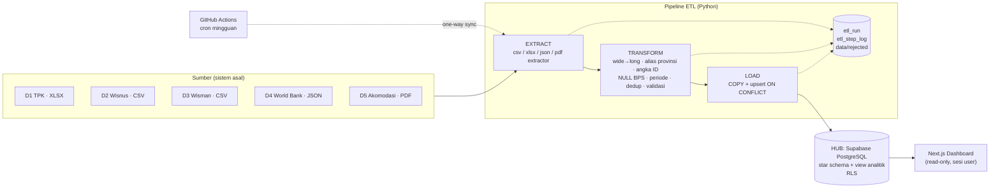
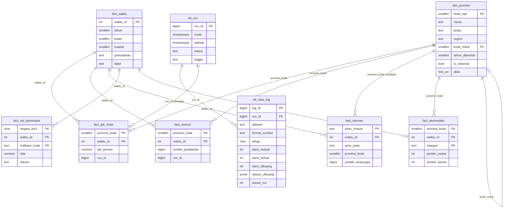

# Laporan Tugas Kelompok
## Integrasi Data Pariwisata Indonesia dengan Pendekatan *Data-level Enterprise Application Integration*

**Mata Kuliah:** Enterprise Application Integration
**Program Studi:** Teknologi Sains Data, Fakultas Teknologi Maju dan Multidisiplin, Universitas Airlangga
**Kelompok:** *[nama kelompok]*
**Anggota:** *[lihat Bab 10]*

| Tautan | Nilai |
|---|---|
| Repository | https://github.com/Mikeljeksen/eai-dashboard-pariwisata |
| Website | *[URL Vercel]* |
| Akun demo | `demo@pariwisata.id` / `Demo-KPjFK4wp1GMUFx!9` |

---

## 1. Pendahuluan

Data pariwisata Indonesia tersebar di banyak penerbit dan dalam format yang berbeda-beda. Badan Pusat Statistik (BPS) merilis tabel statistik bulanan dalam XLSX/CSV dan publikasi tahunan dalam PDF, sementara lembaga internasional seperti World Bank menyediakan data lewat API JSON. Masing-masing sumber memakai konvensi sendiri: penulisan nama provinsi ("KEP. RIAU" vs "Kepulauan Riau"), format angka ("1.412" sebagai ribuan vs "49.17" sebagai desimal), penanda nilai kosong ("-", "…", "—"), tata letak tabel (lebar dengan kolom bulan), sampai artefak publikasi seperti watermark. Akibatnya, pertanyaan lintas sumber seperti *"apakah provinsi dengan perjalanan wisatawan nusantara tinggi juga memiliki hunian hotel tinggi?"* tidak dapat dijawab langsung.

Proyek ini menerapkan **Enterprise Application Integration (EAI) pada level data**. Lima sumber heterogen diintegrasikan ke **satu basis data terpusat (Supabase PostgreSQL)** yang berperan sebagai *hub*, melalui pipeline **Extract → Transform → Load (ETL)**. Di atas hub dibangun website dashboard *Exploratory Data Visualization* (EVD) dengan fitur login. Dashboard tidak pernah membaca file mentah; semua data berasal dari hub.

## 2. Tema dan Tujuan

**Tema:** Pariwisata Indonesia, mencakup sisi permintaan (wisatawan mancanegara dan nusantara), kinerja akomodasi (tingkat penghunian kamar), kapasitas penawaran (jumlah usaha dan kamar akomodasi), serta posisi Indonesia di kawasan ASEAN.

**Tujuan:**
1. Mengintegrasikan 5 dataset publik berformat berbeda (XLSX, CSV, JSON, PDF) ke satu hub dengan kunci bersama **provinsi** dan **periode**.
2. Mengimplementasikan pipeline ETL yang terdokumentasi, idempoten, dan tercatat (*auditable*) di setiap tahapnya.
3. Menyediakan dashboard EVD dengan autentikasi untuk mengeksplorasi tren, musiman, dampak COVID-19 dan pemulihannya, ketimpangan antarprovinsi, serta korelasi lintas dataset.
4. Menunjukkan nilai tambah integrasi: analisis yang tidak mungkin dilakukan dari satu sumber saja.

## 3. Sumber Data

| # | Dataset | Penerbit | Format | Cakupan | Kunci integrasi | Tabel fakta |
|---|---|---|---|---|---|---|
| D1 | Tingkat Penghunian Kamar (TPK) Hotel Bintang | BPS | **XLSX** (8 file) | 38 prov + nasional, bulanan 2018–2025 | provinsi, bulan | `fact_tpk_hotel` |
| D2 | Perjalanan Wisatawan Nusantara menurut Provinsi Tujuan | BPS | **CSV** (7 file) | 38 prov + nasional, bulanan 2019–2025 | provinsi, bulan | `fact_wisnus` |
| D3 | Kunjungan Wisman per Bulan menurut Pintu Masuk | BPS | **CSV** (8 file) | 26 pintu masuk + lainnya, bulanan 2018–2025 | pintu masuk → provinsi, bulan | `fact_wisman` |
| D4 | International Tourism (WDI) Indonesia & 5 negara ASEAN | World Bank | **JSON** (API publik) | tahunan 2010–2020 | tahun (nasional) | `fact_wb_pariwisata` |
| D5 | Statistik Hotel dan Akomodasi Lainnya di Indonesia 2025, Lampiran 1, 2, 5, 6 | BPS | **PDF** (176 hlm) | 38 prov + nasional, tahunan 2021–2025 | provinsi, tahun | `fact_akomodasi` |

Empat format berbeda digunakan. Rentang tahun saling beririsan dan mencakup masa sebelum COVID (2018–2019), saat COVID (2020–2022), dan sesudahnya (2023–2025). Rincian URL, tanggal akses (19 Oktober 2026), lisensi, dan alasan pemilihan ada di `data/SOURCES.md`.

**Catatan pengambilan data.** Situs bps.go.id memblokir unduhan otomatis lewat script (HTTP 403 Cloudflare), sehingga file D1–D3 diunduh lewat tombol *Unduh* di browser (satu file per tahun) dan salinan mentahnya disimpan di `data/raw/` tanpa diubah. ETL memproses salinan mentah tersebut. File PDF D5 dan JSON D4 diunduh langsung.

## 4. Arsitektur Data-level EAI

Kaitan dengan konsep data-level EAI:

- **Extract–process–update.** Data diekstrak dari sistem asal tanpa mengubah sumber (*extract*), diolah di lapisan transformasi (*process*), lalu basis data tujuan diperbarui (*update*) dengan upsert. Setiap tahap mencatat jumlah baris masuk, keluar, dan dibuang ke `etl_step_log`.
- **Data transformation.** Skema dan semantik sumber yang berbeda dipetakan ke skema kanonik hub (dimensi provinsi dan waktu yang seragam). Rinciannya ada di Bab 5.
- **Replication/synchronization.** Hub menyimpan replika data sumber yang sudah dibersihkan. Sinkronisasinya **satu arah (one-way)**: perubahan selalu mengalir dari sumber ke hub dan tidak pernah sebaliknya. Workflow GitHub Actions `etl.yml` menjalankan sinkronisasi ini setiap minggu (`trigger = scheduled`) dan bisa dipicu manual. Load bersifat **idempoten** (`INSERT … ON CONFLICT DO UPDATE`), sehingga sinkronisasi ulang tidak menggandakan data. Ini terbukti di run kedua: D1 mencatat "0 baru, 3.456 diperbarui".
- **Hub-and-spoke.** Semua konsumen (dashboard, ekspor CSV, analisis laporan) membaca dari hub yang sama, bukan dari masing-masing sumber.
- **Keamanan di hub.** Row Level Security aktif; role `authenticated` hanya boleh `SELECT`, `anon` ditolak sepenuhnya (`permission denied`, teruji lewat REST API dengan anon key), dan penulisan hanya lewat koneksi ETL.

## 5. Detail ETL per Dataset

Angka diambil dari `etl_step_log` run sukses terakhir. Baris yang dibuang beserta alasannya tersimpan di `data/rejected/<dataset>_rejected.csv`.

| Dataset | E: file → baris mentah | T: sel masuk | T: dibuang | L: dimuat |
|---|---|---|---|---|
| D1 TPK (XLSX) | 8 → 344 | 3.744 | 288 | 3.456 |
| D2 Wisnus (CSV) | 7 → 301 | 3.276 | 144 | 3.132 |
| D3 Wisman (CSV) | 8 → 312 | 3.360 | 611 | 2.749 |
| D4 World Bank (JSON) | 1 → 360 | 360 | 131 | 229 |
| D5 Akomodasi (PDF) | 1 → 168 | 780 | 40 | 370 |
| **Total** | | **11.520** | **1.214** | **9.936** |

### D1 — TPK Hotel Bintang (XLSX)
- **Masalah:** tabel lebar (provinsi × 12 kolom bulan + "Tahunan"), header 4 baris, angka tersimpan sebagai teks dengan titik desimal ("49.17"), nama provinsi HURUF BESAR, dan nilai "-" untuk 4 provinsi pemekaran Papua sebelum terbentuk.
- **Penanganan:** wide→long; header diurai untuk mengambil tahun; nama provinsi dicocokkan via tabel alias; baris INDONESIA disimpan sebagai kode 0; angka dikonversi ke `numeric(5,2)` dengan validasi 0–100%.
- **Hasil:** 288 sel dibuang karena kosong (4 provinsi pemekaran × 12 bulan × 6 tahun, 2018–2023). Kolom "Tahunan" tidak dimuat, tetapi dipakai untuk cek silang: rata-rata 12 bulan = nilai Tahunan BPS (±2 poin) pada **39/39** baris yang lengkap.

### D2 — Perjalanan Wisatawan Nusantara (CSV)
- **Masalah:** bentuk tabel sama dengan D1, tetapi satuannya jumlah perjalanan (bilangan bulat besar) dan ada kolom "Tahunan".
- **Penanganan:** wide→long, alias provinsi, konversi ke `bigint`.
- **Hasil:** 144 sel kosong dibuang (provinsi pemekaran 2019–2021). Cek silang Σ12 bulan = Tahunan cocok di **261/261** baris. Rekonsiliasi Σ38 provinsi = baris nasional cocok di **84/84** bulan (quality check pasca-load).

### D3 — Kunjungan Wisman per Pintu Masuk (CSV)
- **Masalah:** baris detail bercampur dengan subtotal ("A. Pintu Udara", "B. Pintu Laut", "C. Pintu Darat", "Jumlah (A+B+C)", "Total"), sehingga data akan terhitung ganda bila dimuat apa adanya. Sumber juga tidak memakai kunci provinsi.
- **Penanganan:** 480 sel baris subtotal dibuang, tetapi dipakai untuk validasi Σdetail = Total (**96/96** bulan cocok). Setiap pintu masuk dipetakan ke jenis (udara/laut/darat) dan provinsi lokasinya lewat tabel referensi `data/reference/pintu_masuk_provinsi.csv`. Contoh: Ngurah Rai → Bali, Batam → Kepulauan Riau, Entikong → Kalimantan Barat. Soekarno-Hatta dipetakan ke Banten sesuai lokasi administratifnya. Kelompok "Lainnya" disimpan dengan provinsi NULL agar tetap masuk total nasional.
- **Hasil:** 131 sel kosong dibuang (terutama baris "Lainnya" yang seluruhnya "-").

### D4 — World Bank WDI (JSON)
- **Masalah:** JSON bersarang (`indicator.id`, `country.value`). Data pariwisata World Bank baru dirilis sampai 2020, sehingga nilai 2021–2024 null.
- **Penanganan:** *flatten* JSON, normalisasi tahun ke `waktu_id = YYYY00`, penamaan indikator dan satuan dalam Bahasa Indonesia.
- **Hasil:** 131 record null dibuang. Validasi lintas sumber menunjukkan kedatangan internasional World Bank **identik** dengan total wisman BPS untuk 2018–2020 (selisih 0,00%). Ini membuktikan bahwa pemetaan dan agregasi D3 benar.

### D5 — Akomodasi (PDF)
- **Masalah:** (1) huruf watermark diagonal "https://www.bps.go.id" menyusup ke sel tabel, misalnya `"d\n398"` dan `"i\n.\n870"`; (2) superskrip catatan kaki "1" menempel pada angka, misalnya 695 terbaca **6951**; (3) angka format Indonesia "1.412"; (4) tanda "—" untuk provinsi yang belum terbentuk terbaca sebagai karakter rusak U+FFFD; (5) data tersebar di 4 tabel terpisah (usaha/kamar × semua akomodasi/hotel bintang).
- **Penanganan:** extractor mencari halaman berdasarkan judul lampiran (bukan nomor halaman). Karakter watermark dibuang berdasarkan ukuran font (>15 pt, **84 karakter**), superskrip (<5 pt) diganti penanda lalu dilepas dari angka (**11 angka**). Format angka Indonesia dinormalisasi, U+FFFD diubah menjadi NULL, keempat tabel di-*pivot* menjadi satu baris per provinsi-tahun-kategori, dan dilakukan validasi logis "jumlah kamar ≥ jumlah usaha".
- **Hasil:** 40 sel kosong dibuang, 370 baris dimuat.

### Penanganan 34 vs 38 provinsi
Pada 2022, Papua dimekarkan menjadi Papua, Papua Selatan, Papua Tengah, dan Papua Pegunungan, dan Papua Barat menjadi Papua Barat serta Papua Barat Daya. Data disimpan sesuai publikasi (38 provinsi). Nilai provinsi baru sebelum terbentuk tidak diisi atau diimputasi. Kolom `dim_provinsi.kode_induk` menunjuk provinsi induk, sehingga dashboard menyediakan opsi **basis 34 provinsi** yang menjumlahkan (atau merata-ratakan, untuk TPK) provinsi pemekaran ke induknya agar runtun waktu tetap sebanding.

## 6. Skema Database

**View analitik** (semuanya `security_invoker = true` agar RLS tetap berlaku):
- `v_tren_bulanan`: wisman, wisnus, dan TPK nasional per bulan.
- `v_kpi_tahunan`: KPI tahunan beserta perubahan YoY dan jumlah bulan yang terisi.
- `v_integrasi_provinsi_tahun`: tabel integrasi kelima dataset per provinsi-tahun, termasuk rasio turunan *wisnus per kamar*.
- `v_data_terintegrasi`: semua fakta dalam format panjang untuk halaman Tabel Data dan ekspor CSV.
- `v_etl_ringkasan_sumber`: ringkasan run ETL per sumber untuk halaman Pipeline.

`waktu_id = tahun × 100 + bulan` (bulan 00 untuk data tahunan) menyeragamkan granularitas bulanan dan tahunan dalam satu dimensi waktu.

## 7. Fitur dan Desain Website

Stack: Next.js 15 (App Router, TypeScript), Tailwind CSS v4, ECharts, Supabase Auth (`@supabase/ssr`). Gaya visual **glassmorphism** dengan palet *Aurora* (ungu #7c3aed – biru #2563eb – hijau #10b981) di atas latar gelap #0b0b1a. Latar memiliki empat *blob* gradien yang bergerak pelan dan berhenti bila pengguna mengaktifkan `prefers-reduced-motion`. Tema ECharts kustom memakai warna seri aurora, gridline transparan, dan tooltip *glass*. Teks utama #f4f4fb di atas #0b0b1a memenuhi kontras WCAG AA. Layout responsif sampai 375 px, dengan *skeleton loading* dan *empty state*.

| Halaman | Isi | Screenshot |
|---|---|---|
| `/login`, `/register` | Kartu glass di tengah layar, validasi form (email, password minimal 8 karakter dengan huruf dan angka, konfirmasi), pesan error Bahasa Indonesia | *[screenshot]* |
| `/dashboard` (Overview) | KPI (wisman, wisnus, TPK, kamar akomodasi + YoY) dengan filter tahun; tren bulanan dua sumbu dengan anotasi COVID; heatmap indeks musiman; indeks pemulihan (2019 = 100); pintu masuk teratas; pembanding ASEAN | *[screenshot]* |
| `/provinsi` | Peta choropleth 38 provinsi (skala log), ranking, ketimpangan (pangsa 5 teratas & Gini), scatter korelasi lintas dataset dengan nilai r, filter tahun/metrik/basis 34–38 provinsi | *[screenshot]* |
| `/pipeline` | Diagram alur sumber → E → T → L → hub → dashboard, sankey aliran baris (dimuat vs dibuang per alasan), kartu per sumber, riwayat `etl_run`, isi `etl_step_log`, penjelasan 10 transformasi | *[screenshot]* |
| `/data` | Tabel hasil integrasi dengan pencarian, filter dataset/provinsi/tahun, sort, pagination di server, dan ekspor CSV sesuai filter | *[screenshot]* |

Semua halaman kecuali login/register dilindungi middleware. Query data dijalankan di server (Server Components dan Route Handler) memakai sesi user, sehingga service role key tidak pernah sampai ke browser.

## 8. Analisis Insight

Semua angka berikut diperoleh dari query ke hub (`python -m etl.insights`), bukan dari file mentah.

**Insight 1 — Pukulan COVID-19 jauh lebih dalam pada wisman daripada wisnus.**
*Temuan + angka:* Kunjungan wisman turun dari 16,11 juta (2019) menjadi 4,05 juta (2020, −74,8%) dan mencapai dasar 1,56 juta pada 2021 (9,7% dari level 2019). Titik terendah bulanan terjadi pada Februari 2021 dengan 105.788 kunjungan. Sebaliknya, perjalanan wisnus hanya turun 27,4% pada 2020 (722,2 juta → 524,6 juta) dan sudah naik lagi 16,9% pada 2021.
*Interpretasi:* Penutupan perbatasan internasional menghentikan pasar mancanegara hampir total, sedangkan permintaan domestik lebih tangguh dan menjadi penopang industri selama pandemi. Kebijakan pemulihan jangka pendek yang menyasar wisnus terbukti tepat.

**Insight 2 — Pemulihan wisnus melampaui level pra-pandemi jauh lebih cepat daripada wisman.**
*Temuan + angka:* Wisnus 2025 mencapai 1,20 miliar perjalanan, atau **166%** dari level 2019. Wisman 2025 (15,39 juta) baru **95,5%** dari level 2019. TPK hotel bintang 2025 (49,23%) bahkan masih **4,6 poin** di bawah 2019 (53,80%) dan turun 3,27 poin dibanding 2024.
*Interpretasi:* Volume perjalanan sudah pulih, tetapi hunian hotel bintang belum. Insight 8 menunjukkan bahwa salah satu penjelasannya adalah pertumbuhan kapasitas kamar yang lebih cepat daripada permintaan. Lonjakan wisnus juga perlu dibaca hati-hati karena metodologinya berbasis *mobile positioning data*. `[VERIFIKASI: cek catatan metodologi BPS bila ada perubahan cakupan MPD antartahun]`

**Insight 3 — Pola musiman: wisman memuncak Juli–Agustus, wisnus memuncak saat libur Lebaran dan akhir tahun.**
*Temuan + angka:* Pada tahun normal (2018, 2019, 2023–2025), indeks musiman wisman tertinggi terjadi pada Agustus (115,7) dan Juli (114,2) dan terendah pada Januari (85,0). Wisnus memuncak pada Desember (117,5) dan April (112,5), yang bertepatan dengan libur akhir tahun dan Idulfitri pada beberapa tahun pengamatan. TPK tertinggi terjadi pada Desember (111,3) dan November (107,9).
*Interpretasi:* Wisman mengikuti musim liburan musim panas negara asal (Eropa, Australia), sedangkan wisnus mengikuti kalender libur nasional. Pengelola destinasi bisa memanfaatkan perbedaan puncak ini untuk mengisi kapasitas sepanjang tahun, misalnya mempromosikan pasar domestik pada Juli–Agustus di destinasi yang kurang diminati wisman. `[VERIFIKASI: tanggal Idulfitri bergeser tiap tahun; puncak April bersifat rata-rata]`

**Insight 4 — Konsentrasi pintu masuk wisman makin tinggi ke Bali.**
*Temuan + angka:* Bandara Ngurah Rai menyumbang **48,0%** wisman pada 2019 dan naik menjadi **53,2%** pada 2025 (6,91 juta kunjungan). Soekarno-Hatta naik dari 18,6% ke 21,3%. Pintu darat "lainnya" turun dari 14,6% menjadi 8,4%, dan Batam turun dari 15,0% menjadi 12,3%.
*Interpretasi:* Pemulihan wisman sangat bergantung pada satu gerbang. Ini menjadi risiko konsentrasi (bencana atau gangguan di Bali langsung berdampak nasional) sekaligus tanda bahwa agenda pengembangan destinasi prioritas di luar Bali belum terlihat dalam data pintu masuk.

**Insight 5 — Ketimpangan antarprovinsi: Jawa menyerap 64,8% wisnus dengan 44,5% kamar.**
*Temuan + angka:* Pada 2025, lima provinsi teratas (Jawa Timur 18,1%, Jawa Barat 17,6%, Jawa Tengah 12,2%, DKI Jakarta 8,3%, Banten 5,2%) menyumbang **61,4%** perjalanan wisnus, dengan koefisien Gini antarprovinsi **0,67**. Pulau Jawa menerima 64,8% wisnus tetapi hanya memiliki 44,5% kamar akomodasi.
*Interpretasi:* Wisnus didominasi perjalanan jarak dekat antardaerah di Jawa yang padat penduduk. Ketidakseimbangan permintaan dan kapasitas di Jawa menunjukkan banyak perjalanan yang tidak menginap di akomodasi komersial (kunjungan keluarga, perjalanan harian), sementara luar Jawa memiliki kapasitas yang relatif lebih besar daripada permintaannya.

**Insight 6 — Korelasi lintas dataset: kapasitas mengikuti permintaan, tetapi hunian hanya berkorelasi lemah.**
*Temuan + angka:* Antarprovinsi pada 2025 (n = 38): korelasi log(kamar akomodasi) dengan log(wisnus) **r = 0,91** (positif kuat); log(kamar hotel bintang) dengan TPK **r = 0,52** (sedang); log(wisnus) dengan TPK **r = 0,37** (lemah); wisman per pintu masuk dengan TPK **r = 0,39**.
*Interpretasi:* Analisis ini hanya mungkin dilakukan setelah integrasi, karena keempat variabel berasal dari tiga sumber dan tiga format berbeda (CSV, PDF, XLSX). Kapasitas akomodasi tumbuh mengikuti volume wisatawan, tetapi tingkat hunian ditentukan oleh faktor lain, terutama komposisi wisatawan (wisman cenderung menginap di hotel bintang) dan kesesuaian kelas hotel. Banyak wisnus belum tentu berarti hotel penuh. `[VERIFIKASI: korelasi bukan kausalitas; n kecil]`

**Insight 7 — Tekanan permintaan per kamar berbeda sekitar 15 kali antarprovinsi.**
*Temuan + angka:* Rasio wisnus per kamar akomodasi 2025 tertinggi ada di Banten (2.636), Jawa Timur (2.170), dan Lampung (2.126). Terendah ada di Bali (171) dan Kepulauan Riau (207). Meski rasionya paling rendah, Bali memiliki TPK tertinggi (60,62%).
*Interpretasi:* Rasio rendah di Bali bukan berarti kelebihan pasokan, melainkan karena hunian Bali ditopang wisman (Insight 4), yang tidak tercakup dalam data wisnus. Ini menegaskan bahwa analisis pasokan-permintaan harus menggabungkan D2, D3, dan D5. Satu sumber saja akan menyesatkan.

**Insight 8 — Kapasitas tumbuh lebih cepat daripada hunian.**
*Temuan + angka:* Jumlah kamar akomodasi nasional naik dari 718.898 (2021) menjadi 969.329 (2025, +34,8%), dengan lonjakan +24,5% pada 2024. Pertumbuhan tertinggi terjadi di NTB (+162,9%) dan Bali (+96,4%). Pada periode yang sama, TPK hotel bintang 2025 turun ke 49,23% dari 52,50% (2024).
*Interpretasi:* Penambahan kapasitas yang agresif, terutama di destinasi super prioritas seperti Mandalika (NTB), belum diimbangi permintaan, sehingga hunian rata-rata tertekan. `[VERIFIKASI: lonjakan 2024 mungkin juga dipengaruhi pemutakhiran direktori usaha BPS, bukan murni pembangunan baru]`

**Insight 9 — Posisi Indonesia di ASEAN: volume kalah, nilai per wisatawan kompetitif.**
*Temuan + angka:* Pada 2019 Indonesia menerima 16,1 juta kedatangan internasional, di bawah Thailand (39,9 juta), Malaysia (26,1 juta), Singapura (19,1 juta), dan Vietnam (18,0 juta). Namun penerimaan per kedatangan Indonesia sebesar **US$ 1.143**, lebih tinggi daripada Malaysia (US$ 851) dan Vietnam (US$ 657), meski masih di bawah Thailand (US$ 1.613). Penerimaan Indonesia anjlok dari US$ 18,41 miliar (2019) menjadi US$ 3,53 miliar (2020).
*Interpretasi:* Strategi *quality over quantity* memiliki dasar data. Indonesia lebih unggul dalam nilai belanja per wisatawan daripada jumlahnya.

**Insight 10 — Validasi lintas sumber membuktikan integritas integrasi.**
*Temuan + angka:* Total wisman hasil ETL dari CSV BPS (agregasi 26 pintu masuk + lainnya) sama persis dengan kedatangan internasional World Bank (JSON): 2018: 15.810.305 vs 15.810.000; 2019: 16.106.954 vs 16.107.000; 2020: 4.052.923 vs 4.053.000. Selisihnya 0,00% (World Bank membulatkan ke ribuan).
*Interpretasi:* Dua sumber, dua format, dan dua penerbit yang berbeda menghasilkan angka yang sama setelah integrasi. Ini bukti bahwa transformasi D3 (pembuangan subtotal, pemetaan pintu masuk) tidak menghilangkan atau menggandakan data.

## 9. Kesimpulan dan Keterbatasan

**Kesimpulan.**
1. Lima sumber heterogen (XLSX, CSV, JSON, PDF) berhasil diintegrasikan ke satu hub Supabase PostgreSQL melalui pipeline ETL yang terdokumentasi. Dari 11.520 sel data, 9.936 baris dimuat dan 1.214 dibuang dengan alasan yang tercatat.
2. Pipeline memenuhi prinsip data-level EAI: *extract–process–update*, transformasi skema ke model kanonik, dan sinkronisasi satu arah yang idempoten dan terjadwal.
3. Integrasi menghasilkan analisis yang tidak bisa diperoleh dari satu sumber, seperti korelasi kapasitas–permintaan–hunian per provinsi dan validasi silang BPS–World Bank.

**Keterbatasan.**
- Data World Bank berhenti di 2020, sehingga pembanding ASEAN belum mencakup masa pemulihan.
- Wisnus berbasis *mobile positioning data* yang tersedia sejak 2019. Perbandingan dengan survei lama tidak dilakukan.
- Pemetaan pintu masuk → provinsi mewakili lokasi kedatangan, bukan destinasi akhir wisman (misalnya, wisman yang tiba di Soekarno-Hatta bisa berwisata ke Jawa Barat).
- Data akomodasi (PDF) hanya mencakup 2021–2025 dan berasal dari satu edisi publikasi. Angka 2025 merupakan hasil pemutakhiran direktori.
- File BPS diunduh lewat browser karena situs memblokir unduhan otomatis. Sinkronisasi terjadwal memproses salinan di repo, sehingga pembaruan sumber masih membutuhkan langkah unduh manual. Pengembangan lanjut dapat memakai WebAPI BPS (membutuhkan API key).

## 10. Pembagian Tugas Kelompok

| Nama | NIM | Kontribusi |
|---|---|---|
| *[Nama 1]* | *[NIM]* | *[mis. pencarian dataset, ETL]* |
| *[Nama 2]* | *[NIM]* | *[mis. desain database, migrasi]* |
| *[Nama 3]* | *[NIM]* | *[mis. frontend & visualisasi]* |
| *[Nama 4]* | *[NIM]* | *[mis. laporan & analisis insight]* |

## 11. Daftar Pustaka dan Sumber Data

1. Badan Pusat Statistik. (2026). *Tingkat Penghunian Kamar pada Hotel Bintang* [Tabel statistik, XLSX]. https://www.bps.go.id/id/statistics-table/2/MTIyIzI=/tingkat-penghunian-kamar-hotel.html. Diakses 19 Oktober 2026.
2. Badan Pusat Statistik. (2026). *Jumlah Perjalanan Wisatawan Nusantara Menurut Provinsi Tujuan* [Tabel statistik, CSV]. https://www.bps.go.id/id/statistics-table/2/MjIwMSMy/. Diakses 19 Oktober 2026.
3. Badan Pusat Statistik. (2026). *Jumlah Kunjungan Wisatawan Mancanegara per Bulan ke Indonesia Menurut Pintu Masuk, 2008–sekarang* [Tabel statistik, CSV]. https://www.bps.go.id/id/statistics-table/2/MTE1MCMy/. Diakses 19 Oktober 2026.
4. Badan Pusat Statistik. (2025). *Statistik Hotel dan Akomodasi Lainnya di Indonesia 2025* (No. Publikasi 06300.25009) [PDF]. https://www.bps.go.id/id/publication/2025/12/31/cc7df681d36107bb009a1e82/.
5. World Bank. (2026). *World Development Indicators: International tourism (ST.INT.ARVL, ST.INT.RCPT.CD, ST.INT.XPND.CD, ST.INT.DPRT)* [API JSON]. https://api.worldbank.org/v2/. Lisensi CC BY 4.0.
6. Herianto, D. *Indonesia GeoJSON & TopoJSON Maps (38 Provinces)*. https://github.com/denyherianto/indonesia-geojson-topojson-maps-with-38-provinces. Lisensi CC BY 4.0.
7. Linthicum, D. S. (2000). *Enterprise Application Integration*. Addison-Wesley.
8. Hohpe, G., & Woolf, B. (2003). *Enterprise Integration Patterns*. Addison-Wesley.
